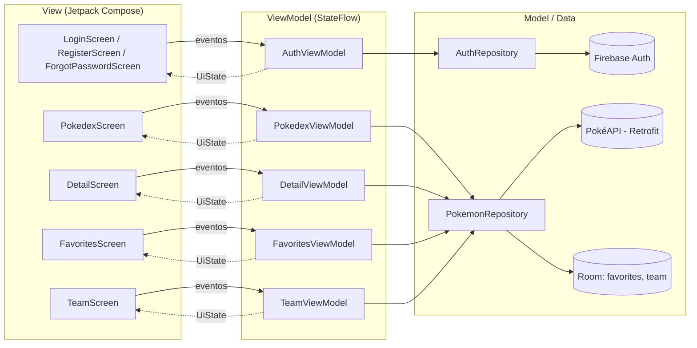

# PokéTeam ⚡️ — Pokédex com time favorito

Aplicativo Android nativo (Kotlin + Jetpack Compose) para explorar a Pokédex, favoritar Pokémon e **montar um time de até 6**. Funciona offline para tudo o que o usuário salvou.

> Projeto da **Prova 06 — Programação Para Dispositivos Móveis** (ADS · IFTM Campus Patrocínio)
> **Autor:** Paulo Henrique Marques Silva

| | |
|---|---|
| 🎨 Protótipo no Figma | **https://www.figma.com/design/QzJfXxNifGYmGGKYzhbJAC/Untitled?node-id=0-1&t=sRaGRbL2PCuRSwhR-1** |
| 🎥 Vídeo demonstrativo | **https://youtu.be/241C7-lWZN0** |

---

## 1. Proposta de valor

Quem joga, assiste ou coleciona Pokémon quer três coisas: **achar** um Pokémon rápido, **entender** seus tipos e atributos, e **guardar** os preferidos. O PokéTeam resolve isso em um app leve:

- **Explorar** os +1.000 Pokémon com lista paginada (carrega aos poucos, sem travar).
- **Buscar** por nome ou número da Pokédex.
- **Ver detalhes**: imagem oficial, tipos coloridos, altura, peso e status base.
- **Favoritar** e **montar o time dos sonhos** (limite de 6, como nos jogos).
- **Usar offline**: favoritos e time ficam salvos no aparelho (Room) e abrem sem internet.
- **Conta própria** com Firebase Authentication (cadastro, login e recuperação de senha).

## 2. Funcionalidades

- [x] Cadastro, login e recuperação de senha (Firebase Auth) + sessão persistida
- [x] Lista paginada (scroll infinito) consumindo a PokéAPI
- [x] Busca com *debounce* (350 ms)
- [x] Tela de detalhe com tipos e barras de status
- [x] Favoritos (Room)
- [x] Time de até 6 Pokémon com regras (sem repetir, máximo de 6) (Room)
- [x] Modo offline para favoritos/time (snapshot salvo no Room)
- [x] Estados de carregamento, erro com "tentar novamente" e telas vazias
- [x] Navegação com bottom bar (Pokédex · Favoritos · Meu time) e tela de detalhe

## 3. Stack

| Camada | Tecnologia |
|---|---|
| Linguagem / UI | Kotlin, Jetpack Compose, Material 3 |
| Arquitetura | MVVM + Repository, `StateFlow` |
| Navegação | Navigation Compose |
| Autenticação | Firebase Authentication (e-mail/senha) |
| Persistência | Room (favoritos e time) |
| API REST | [PokéAPI](https://pokeapi.co/) via Retrofit + Gson |
| Imagens | Coil |
| Injeção de dependência | Manual (`AppContainer`) |

## 4. Arquitetura MVVM



### Fluxo de gerenciamento de estado

1. A **View** (composable) é *stateless*: apenas **observa** um `StateFlow<UiState>` com `collectAsStateWithLifecycle()` e **dispara eventos** chamando funções do ViewModel (`onQueryChange`, `loadNext`, `toggleFavorite`...).
2. O **ViewModel** mantém um `MutableStateFlow<UiState>` privado e expõe somente `StateFlow` imutável. Cada evento atualiza o estado com `_state.update { it.copy(...) }` dentro de `viewModelScope`.
3. O **Repository** é a única fonte de dados: decide entre rede (PokéAPI) e banco (Room). O Room expõe `Flow`, então **qualquer mudança no banco atualiza a tela automaticamente** (ex.: favoritar no detalhe atualiza o coração na lista e a aba Favoritos).
4. Fluxo de **uma ação** (favoritar): `DetailScreen` → `DetailViewModel.toggleFavorite()` → `PokemonRepository.toggleFavorite()` → `PokemonDao` (Room) → `Flow` emite → ViewModels observadores atualizam `UiState` → Compose recompõe.

Exemplo de `UiState` (lista paginada):

```kotlin
data class PokedexUiState(
    val items: List<PokemonSummary>, val results: List<PokemonSummary>,
    val query: String, val isLoading: Boolean, val isSearching: Boolean,
    val endReached: Boolean, val error: String?, val favoriteIds: Set<Int>
)
```

### Decisões técnicas

- **Paginação**: `limit=20&offset=N` na PokéAPI; a UI pede a próxima página quando faltam ~4 itens (`derivedStateOf` sobre o `LazyGridState`).
- **Busca**: a PokéAPI não tem endpoint de busca, então o índice de nomes é baixado uma vez e filtrado localmente.
- **Offline**: ao favoritar/entrar no time, salvamos um *snapshot* completo (tipos, status, medidas). Se a rede falhar, `getDetail()` cai para o snapshot do Room.
- **Cancelamento seguro**: `safeCall` não engole `CancellationException`.
- **Auth reativa**: o `NavHost` observa `isLoggedIn` e leva à Pokédex/Login limpando o back stack.

### Estrutura de pastas

```
app/src/main/java/com/paulohenrique/poketeam/
├── data/
│   ├── local/        # Room: entities, DAO, database
│   ├── remote/       # Retrofit: PokeApiService + DTOs
│   ├── repository/   # PokemonRepository, AuthRepository
│   └── Mappers.kt
├── di/               # AppContainer (DI manual)
├── model/            # modelos de domínio
├── ui/
│   ├── auth/  pokedex/  detail/  favorites/  team/   # Screen + ViewModel
│   ├── components/   # TypeChip, PokemonCard, ...
│   ├── navigation/   # Routes + NavHost + BottomBar
│   └── theme/
└── util/
```

## 5. Como rodar (build e execução)

**Requisitos:** Android Studio (versão recente, ex.: Ladybug ou mais nova), JDK 17 (já vem no Android Studio), dispositivo/emulador com Android 8.0+ (API 26+) e internet no primeiro uso.

1. **Clone** o repositório e abra a pasta no Android Studio.
2. **Configure o Firebase** (obrigatório para o login funcionar):
   1. Acesse o [Firebase Console](https://console.firebase.google.com/) → *Adicionar projeto*.
   2. *Adicionar app Android* com o **nome do pacote** `com.paulohenrique.poketeam`.
   3. Baixe o `google-services.json` e coloque em **`app/google-services.json`**.
   4. No console: *Build → Authentication → Sign-in method* → ative **E-mail/senha**.
3. Aguarde o **Gradle Sync** e clique em **Run ▶**.
4. Crie uma conta na tela de cadastro e explore o app.

> O arquivo `google-services.json` está no `.gitignore`. Se o professor precisar executar com o seu projeto Firebase, envie o arquivo separadamente (ou remova a linha do `.gitignore` antes do commit).

## 6. Atendimento aos requisitos da prova

| Requisito | Onde está |
|---|---|
| Kotlin + Jetpack Compose | Todo o projeto (`ui/`) |
| Firebase Authentication (registro, login, recuperação) | `AuthRepository`, `AuthViewModel`, `AuthScreens.kt` |
| Persistência de dados | Room: `data/local/` |
| MVVM + `StateFlow` | `ui/*/…ViewModel.kt` |
| Navigation Compose | `ui/navigation/` |
| Consumo de API REST | `PokeApiService` (PokéAPI) |
| README, Figma e vídeo | Este arquivo (links no topo) |

## 7. Melhorias futuras

- Favoritos/time por usuário (colunas `userId`) e sincronização com Cloud Firestore.
- Filtro por tipo e geração; comparação de Pokémon; análise de fraquezas do time.
- Testes unitários dos ViewModels e testes de UI com Compose.
- Hilt para injeção de dependência.

## 8. Créditos

Dados e imagens: [PokéAPI](https://pokeapi.co/) e [PokeAPI/sprites](https://github.com/PokeAPI/sprites). Pokémon e seus nomes pertencem à Nintendo / Game Freak / The Pokémon Company; este é um projeto acadêmico sem fins lucrativos.
